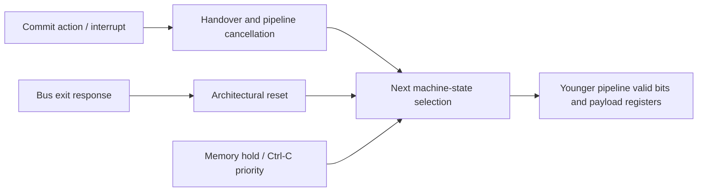

# High-fanout control and FPGA area analysis

Kind: implementation experiment and analysis, 2026-10-28. Baseline is
SimpleRisc `9d29a6b746c4472795ac56516c96b2096e6b70b8`, including the
previously measured compressed branch predictor and two-way cache. The CPU
Haskell and generated CPU RTL are unchanged by this experiment.

## Result

The implemented change replaces the two-way cache's indexed MRU register
vector with a small distributed RAM and a registered lookup. This removes
thousands of resettable registers and associated read/write selection logic
without reducing cache capacity or changing the replacement policy.

| Routed measurement | Original cache | RAM-backed MRU | Change |
|---|---:|---:|---:|
| Logic cells | 19,592 / 20,736 (95%) | 15,911 / 20,736 (77%) | -3,681, or 18.79% |
| Registers | 7,360 | 5,308 | -2,052, or 27.88% |
| Occupied CLS | 10,260 / 10,368 (99%) | 8,856 / 10,368 (86%) | -1,404 |
| BSRAM | 37 / 46 | 37 / 46 | unchanged |
| DSP | 3 / 24 | 3 / 24 | unchanged |
| Reported core Fmax | 51.281 MHz | 52.023 MHz | +0.742 MHz, or 1.45% |
| Worst setup slack at 48 MHz | +1.333 ns | +1.611 ns | +0.278 ns |
| Setup / hold violating endpoints | 0 / 0 | 0 / 0 | unchanged |

These are Gowin's reported utilization percentages. A fresh build of the
original cache reproduced its original resource counts and Fmax exactly.
The gain is primarily **area and placement headroom**. It does not establish
a substantially higher operating clock: the worst path moves into the new
MRU lookup, and large processor control nets remain.

The frozen classifier's RTL performance counters match the original cache
**exactly**, including 136,227,643 measured CPU cycles, 10,840,949 held cycles,
260,069 window refills and 6,566,913 execute redirects. Three physical runs
of the smaller image match the prior combined image's median of
2.805255 seconds. This change saves hardware; it does not claim an additional
classifier speedup at the same clock.

## Controlled build configuration

Both implementations use the same:

- Tang Nano 20K, GW2AR-LV18QN88C8/I7, Gowin V1.9.12.04;
- CPU/SDRAM clocks of 48/48 MHz, 135-degree SDRAM phase, placement option 2;
- frozen RV32IMC generated CPU, SHA-256
  `b2db3d0bd4c05399f7b8b0eb26e508c027b69e018e70571299cc6b9cd05f1030`;
- 64 KiB cache, two ways, 2,048 sets per way, 16-byte lines;
- `LINE_BITS=11`, write-update enabled, four posted writes and four-beat refills;
- boot ROM, controller, clock bridge, pins and internal timing constraints.

The baseline rebuild uses a frozen copy of the original cache source through
an absolute `SDRAM_CACHE_RTL` override. The candidate uses the modified
production cache. Output paths differ; logical parameters and the CPU are
held fixed. The mapper can change the implementation of unchanged modules
when the surrounding design changes, so whole-design area changes should
not be interpreted as a count of source-level expressions removed.

The classifier simulation uses 72/54 MHz to match the preceding controlled
matrix and its frozen guest timer. Physical tests use 48/48 MHz. These are
separate measurements; simulation success at 72 MHz is not physical timing
qualification at that frequency.

## What the original high-fanout report actually shows

| Original net | Loads | Source-level meaning / interpretation |
|---|---:|---|
| `clk` | 7,454 | The intended clock network; distinguish this from data/control fanout |
| `memory_reset_sync[1]` | 4,919 | Synchronous reset distributed across core and cache registers |
| `core/machine_0_50_9` | 1,778 | Processor-state clock enable: `advance || breaking` |
| `cache/n19474_17`, `cache/n19474_18` | 1,000 each | Replicated MRU update/reset control |
| `cache/way2_5`, `cache/way2_6` | 1,000 each | Replicated MRU write data / selected-way state |
| `core/machine_0_0[5492]` | 993 | `cpuFast`, choosing pipelined versus slow-phase execution |
| `core/machine_0_5492_7` | 991 | A synthesized copy of the same broad mode control |

The processor-enable identification is checked against the synthesized LUT:
`LUT3 machine_0_50_s3`, `INIT=8'hAE`, with inputs `advance`, `emergency` and
`machine_0_0[1737]`. The generated CPU identifies bit 1737 as `cpuInRom`.
The truth table is therefore:

```text
enable = advance || (emergency && !cpuInRom)
       = advance || breaking
```

This has a real semantic purpose. During a cache hold, logical CPU execution
stops, physical counters keep ticking, and Ctrl-C must still reset a running
program into the ROM. Removing `breaking` from a global enable without
redistributing reset ownership would break that behavior.

Similarly, bit 5492 is explicitly assigned to `cpuFast` in the generated
RTL. It is not a generic instruction-decode bit. It determines which of two
execution mechanisms owns the machine, making it a natural source of wide
selection and enable networks.

The clock's fanout is not evidence that it should be replaced with a
logic-generated or gated clock. The original critical path reports zero
clock skew and predominantly data routing delay. No new false paths,
multicycle exceptions or clock gating are introduced here.

## Tracing the original critical paths back to state

The original worst setup path is:

```text
core/machine_0_2598_s1/Q
    -> state/action/hold selection
    -> core/machine_0_4157_s1/D
```

Its data delay is 19.466 ns: 17.022 ns routing (87.44%), 2.212 ns logic and
0.232 ns clock-to-Q. It traverses six logic levels. Intermediate nets on
this path drive 602 and 783 loads. At 48 MHz the available period is
20.833 ns; a 100 MHz target would provide only 10 ns.

The packed-state interpretation can be reconstructed from the generated
assignments and the source record definitions:

| Packed location | Meaning | Reconstruction |
|---|---|---|
| `machine[5491:2035]` | `cpuPipe` | Explicit generated field assignment |
| `machine[2962:2404]` | `cpuPipe.pM` | Valid bit plus 558-bit `MemoryStage` payload |
| `machine[2598]` | High bit of `pM.mAction`'s constructor tag | M payload action is `[194:128]`; 2404 + 194 = 2598 |
| `machine[4287:4154]` | `cpuPipe.pD` | Valid bit plus 133-bit `Fetched` payload |
| `machine[4157]` | `pD.fRaw[0]` | `fSize` occupies the three least-significant payload bits |
| `machine[226:192]` | `cpuBusResponse` | Explicit generated field assignment |
| `machine[192]` | `responseExit` within a present bus response | Last field of `BusResponse`; validity is at bit 226 |

The other leading path starts at `machine[192]`, the finisher/exit response,
and ends in pipeline payload state. The first path starts in the oldest
instruction's action tag. These observations support the following source
trace; they do not identify every mapped LUT as a single Haskell function:



`pipeStepDecodedWith` derives `handover` from `mAction` and the registered
interrupt request, then selects a restarted pipeline. `SdramPipeline.step`
selects held/reset versus active machine state. The top-level circuit stores
the result as one `Machine` value. Its generated representation is 6,862
bits, including the simulation register-file mirror and fields that synthesis
can eliminate or merge; that width is **not** a count of physical flip-flops.

The important structural issue is that cancellation, execution mode and
hold decisions can enter wide payload selection. Invalidating a stage should
usually require changing its validity/control tokens while leaving obsolete
payload bits untouched. The source already does some of this in
`restartPipe` and `systemReset`; the mapped paths show that further separation
of storage enables and next-state selection is needed.

## Why MRU was the first implementation target

The old declaration was an indexed register vector:

```verilog
reg [(1<<LINE_BITS)-1:0] mru;
```

At 2,048 sets, the synthesis netlist contains exactly 2,048 flip-flops whose
outputs are MRU bits. Dynamic reads require a wide bit-selection tree;
indexed writes require per-bit update selection; `mru <= 0` adds a reset
to every bit. The policy stores only 2,048 bits of information, but its
implementation consumes much more than that many bits of FPGA storage.

The new declaration is an unpacked one-bit memory with a distributed-RAM
inference attribute. Gowin maps it to **128 `RAM16SDP1` primitives**, each
holding sixteen replacement bits. The cache's pre-existing data and tag
BSRAM organization is retained. This avoids introducing another narrow
BSRAM mode into a design with a history of device-specific write behavior.

| Cache synthesis primitives | Original | Candidate |
|---|---:|---:|
| Flip-flops, all cache state | 2,497 | 447 |
| LUT2/3/4 primitives | 4,478 | 1,429 |
| Dedicated MUX2_LUT5/6/7/8 primitives | 995 | 81 |
| `RAM16SDP1` | 0 | 128 |

These are pre-route primitive counts, not interchangeable with the routed
whole-chip logic-cell accounting above. The unchanged CPU's mapped primitive
counts also vary under whole-design synthesis, so the complete design and
the module-level changes are reported separately.

### Preserving the old lookup timing and policy

The cache's CPU port remains three logical clocks. The MRU bit is now read
on the same advancing edge as the tag arrays and retained as `entry_mru`.

1. On an advancing edge, the incoming set's MRU bit is captured alongside
   its tags. If that same edge updates the same set, the captured value is
   explicitly forwarded from the write data. This matches what the old
   asynchronous register-vector read observes immediately after the edge.
2. During a hold, that lookup remains stable with the request and tags.
3. If a refill just changed the same set, the existing `same_fill_set`
   override chooses the opposite of `fill_way`, rather than trusting a
   lookup made before the refill.
4. Empty-way priority is unchanged: allocate Way 0, then Way 1, then evict
   the way opposite MRU.
5. Reset initializes MRU through the cache's existing tag-clear sweep.
   `hold_cpu` already prevents requests from advancing during that sweep,
   so clearing does not add CPU startup cycles or require a wide reset.

The explicit lookup/write bypass is necessary. Relying on a particular
same-address RAM read-during-write result would make replacement behavior
depend on the implementation technology.

## What remains after the area reduction

| Reported load count | Original | Candidate |
|---|---:|---:|
| Core clock network | 7,454 | 5,530 |
| Synchronous reset | 4,919 | 2,887 |
| Broad processor enable | 1,778 | 1,776 |
| First reported `cpuFast` copy | 993 | 576 |
| Second reported `cpuFast` copy | 991 | 575 |

The four MRU-related thousand-load nets disappear from the top-ten fanout
list. Reset and clock load counts fall substantially. The broad processor
enable is effectively unchanged: the cache optimization does not solve the
processor's control-storage structure.

The new worst path is `core/request_66_s0/Q` to `cache/entry_mru_s0/D`.
The request bit is the registered bus-active selector. It feeds physical
address selection, the distributed MRU RAM read and selection tree, and
the lookup collision forwarding. The path has 13 logic levels and
19.187 ns data delay: 12.917 ns routing (67.32%), 6.038 ns logic and
0.232 ns clock-to-Q.

The next reported core paths start at `machine[2034]`, the validity bit of
the registered `cpuInterruptDue`, and terminate at mapped arithmetic inputs.
The resource reduction exposes a different balance of bottlenecks. It would
be misleading to describe the smaller design as ready for 72 or 100 MHz.

## Validation and its limits

- All 18 existing cache checks pass, including both write policies, one- and
  two-way geometries, full bank sweeps, undefined tag/data collisions and
  deliberately corrupted protocol/forwarding controls.
- Five new MRU checks pass: small and full two-way caches, full invalidating
  policy, poisoned lookup/write collisions, and a deliberately missing
  collision bypass that must fail. An independent shadow vector implements
  the original update policy and checks replacement decisions while both
  ways are valid. A three-tag trace exercises eviction and repeated hits.
- Generated CPU execution passes for RV32IM/one-way/single-clock and
  RV32IMC/two-way/clock-crossing cases. The tests include masked stores,
  cache aliases, SPI, counter holds, multiply/divide, instruction fencing,
  recovery and rejection of a corrupt backend beat.
- All 19 Maude searches pass. The abstract policy is unchanged; these model
  searches do not constitute equivalence checking of the synthesized RAM.
- The frozen classifier passes the independent reference and matches every
  prior performance counter exactly at 72/54 MHz in RTL simulation.
- Three cold-programmed 48/48 MHz physical classifier runs pass and each
  reports 2.805255 seconds after the frozen guest's 72/48 timer correction.
  Uploads use the same verified legacy `Q/V/H` path as the earlier matrix.
- The synthesized-netlist smoke test exercises a three-tag eviction program
  with the actual inferred RAM primitives. The local `RAM16SDP1` model follows
  the installed GW2A vendor model's asynchronous-read, rising-edge-write and
  `INIT_0` semantics. This is functional simulation, not annotated timing or
  electrical simulation.

The CI workflow now runs and archives the five MRU regressions alongside
the existing cache tests. Hosted CI has not been run for these local changes.
No new clock rate, full example-suite acceptance, large-workload endurance
or SDRAM electrical/PVT qualification is claimed. The known-good one-way
48 MHz preset was restored after the physical experiment and its UART
diagnostic passed. Flash and SD were not programmed.

## Next experiments, in order

1. **Shorten the MRU lookup path.** Evaluate banked registered RAM outputs or
   moving collision selection across the existing lookup boundary. Preserve
   the three-clock CPU port and retain the old-policy shadow and poisoned
   collision tests. Measure added registers, lookup selection delay and
   placement; do not assume banking wins without routing it.
2. **Separate processor payload storage from cancellation tokens.** Start
   with D/A/F queue payloads implicated by the original paths. Give each
   bank a local update enable; flushes should invalidate tokens while
   unused payloads remain held. Preserve precise exceptions, branch recovery,
   register-file writes, memory holds, Ctrl-C and clock counters. Merely
   registering a global hold or break one cycle later would change semantics.
3. **Reduce mode/control coupling.** Trace `cpuFast`, pending interrupts and
   commit actions into the remaining wide selectors. Consider narrower local
   ownership records for fast-pipeline, slow-phase and device state. Keep
   their ownership boundaries explicit rather than adding timing exceptions.
4. **Evaluate payload-width tradeoffs.** E2 retains eight ALU candidates and
   precise trap/branch metadata. Selecting results earlier could save state,
   but it moves combinational work into another stage. It needs a separate
   timing and workload comparison; no such CPU change is included here.
5. **Only then qualify a higher clock.** Build and route at the proposed
   frequency, retain complete setup/hold analysis, and repeat the larger
   physical workloads that previously distinguished 48 MHz from 72 MHz.
   Keep CPU and SDRAM qualification separate.

## Evidence and reproduction

The [evidence directory](evidence/2026-10-28-control-area/README.md) records
source hashes, original and optimized cache snapshots, both fresh timing and
utilization reports, compressed synthesis netlists, extracted analyses,
formal/cache/CPU logs, performance receipts and physical restoration evidence.

The reusable analysis command is:

```bash
python3 boards/tangnano20k/sdram/analyze_implementation.py BUILD_DIRECTORY \
  --out ANALYSIS.json
python3 boards/tangnano20k/sdram/check_cache_mru.py
```

To reproduce the original hardware comparison, use `build.sh pipeline` with
the settings listed above, the frozen CPU from the preceding benchmark,
and an absolute `SDRAM_CACHE_RTL` path selecting either archived cache.
`analyze_implementation.py` reads the synthesis netlist, timing report and
utilization report; it does not change a design or program the board.
