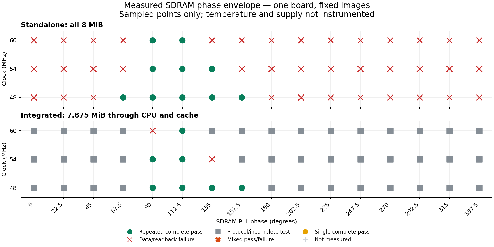

# Measured SDRAM operating envelope: 48, 54 and 60 MHz

Completed on 31 October 2026: all 96 combinations of three frequencies,
sixteen phases and two test types were programmed and observed on the board.
The integrated passing window narrows from four sampled phases at 48 MHz to
two at 54 MHz and one at 60 MHz. Only 48 MHz demonstrates a full phase step of
tolerance on both sides of a tested central setting.

This is a one-board experiment at uninstrumented room conditions, not full
voltage/temperature/process qualification. The supported 48 MHz preset is
unchanged. The saved 54/54 MHz processor image was restored and verified.

## Passing samples and margins

Every listed passing sample completed the full test twice. Ranges list the
22.5-degree samples within their endpoints; they do not assert continuity
between samples. The integrated passing samples are also the intersection
with standalone passing samples in this experiment.

| Clock | Standalone passing samples | Integrated passing samples | Shared sampled span | Observed headroom below / above 112.5 degrees |
| --- | --- | --- | ---: | ---: |
| 48 MHz | 67.5–157.5 degrees | 90–157.5 degrees | 67.5 degrees / 3.906 ns | 22.5 / 45 degrees = 1.302 / 2.604 ns |
| 54 MHz | 90–135 degrees | 90–112.5 degrees | 22.5 degrees / 1.157 ns | 22.5 / 0 degrees = 1.157 / 0 ns |
| 60 MHz | 90–112.5 degrees | 112.5 degrees only | One sampled point | No passing neighbor demonstrated |

Headroom is the distance to the last passing **sample**, not to the electrical
failure boundary. The zero upper headroom at 54 MHz means no higher passing
sample was demonstrated; it does not mean measured electrical slack is zero.
At 48 MHz, either 112.5 or 135 degrees has a passing sample at least one full
step away in both directions. At 54 MHz, neither passing setting has passing
neighbors on both sides. At 60 MHz, the sole passing setting has none.



The immediately adjacent unsuccessful samples bound the acceptance
transitions at the grid resolution:

| Clock | Standalone lower / upper neighbor | Integrated lower / upper neighbor |
| --- | --- | --- |
| 48 MHz | 45 / 180 degrees: memory failures | 67.5 / 180 degrees: protocol incomplete |
| 54 MHz | 67.5 / 157.5 degrees: memory failures | 67.5 degrees: protocol incomplete; 135 degrees: memory failure |
| 60 MHz | 67.5 / 135 degrees: memory failures | 90 degrees: memory failure; 135 degrees: protocol incomplete |

There were 271 board attempts: 34 complete passing runs, 79 memory-failure
runs and 158 protocol/incomplete attempts. The passing runs contain
425,066,496 zero-error word comparisons. Incomplete runs do not qualify a
phase and are not assigned memory-error counts. All 113 conclusive UART
reports were re-parsed offline against the final acceptance code.
All 88 restorations matched the pinned identity/image and passed twelve CRC
probes each, totaling 1,056 recovery probes.

**Decision:** retain 48 MHz as supported. 112.5 degrees is a common measured
passing setting for further experiments at all three frequencies, but these
results do not qualify 54 or 60 MHz for general operation. Those frequencies
lack demonstrated phase tolerance in both directions on this grid. Extending
the envelope requires controlled temperature/supply measurements, additional
boards and routes, and the unresolved SDRAM timing bounds.

## What the failures establish

At 54 MHz and 135 degrees, both integrated runs verified upload and memory
readback CRCs, then failed the all-zero pass with 132 and 92 mismatched words
out of 2,064,384. The first mismatch in each run was `0x00008000` instead of
zero. Standalone testing passed at that phase. A short successful CRC probe
therefore does not establish full-memory correctness even at 54 MHz.

At 60 MHz and 90 degrees, both integrated runs completed upload and memory
readback CRC verification, then passed the zero and one patterns. The address
pattern failed with 2,001 and 1,904 mismatched words respectively out of
2,064,384 comparisons in that pattern. The first mismatch in each run differed
in bit 31. This demonstrates reproducible, data-dependent memory-path corruption
in an internally timing-clean image; successful upload and simple fill patterns
are insufficient acceptance tests.

The standalone tester passed 90 degrees at the same frequency. At 135 degrees,
it too passed the zero and one patterns before failing the address pattern.
Standalone success therefore does not establish the integrated operating
envelope. The evidence implicates memory-path timing sensitivity, but does not
separate read capture, write timing, controller routing, package delay and
signal integrity into individual causes. It also does not measure the size of
the benefit from a different placement or fanout optimization.

## Frozen configuration

- Tang Nano 20K, GW2AR-LV18QN88C8/I7, serial suffix `20250303171`.
- Source revision `b089c9238d1c7e561fbeabf5419e1d3316a2e7b4`.
- Integrated RV32IMC CPU with 128-entry BTB, two-way 64 KiB cache, and
  synchronous CPU/controller clocks at 48, 54 or 60 MHz. No clock crossing
  is exercised by these experiments.
- CAS2, sequential burst4 reads and single-location writes; automatic refresh.
- All sixteen rPLL phase settings, 0 through 337.5 degrees in 22.5-degree steps.
  These are nominal `PSDA_SEL` settings from the
  [Gowin Clock User Guide, table 5-7](https://cdn.gowinsemi.com.cn/UG286E.pdf),
  not oscilloscope measurements of the clock at the memory pins.
- Placement 0, map option 3, route option 1, route max-fanout 8.
  Optimization targets are 53/60/66 MHz respectively; actual SDC constraints
  are 48/54/60 MHz. All programmed images must pass internal setup/hold STA.
- FPGA SRAM programming only. Recovery is the retained 54/54 MHz image with
  SHA-256 `f01fdf0bb48c3f5842cf8f8ad0d7d24bc1a746c9959993089e26a4661e207038`.
  Its ROM identity matches the starting board identity. FPGA bitstream
  readback was not used to establish that the original SRAM bytes were identical.

The source was archived before edits. Fresh ordinary CPU RTL matches the
previously measured 128-entry-BTB RTL byte-for-byte:
`f026208c873d7b66f93d548924bc720d0d86cd105df75b6d0d3da483c27469d1`.
Every build receipt binds the sources, PLL, SDC, ROM, bitstream and timing
report by SHA-256. No hypothetical false-path cuts are used.

### Internal timing cross-check

The 112.5-degree images report the following internal timing. These numbers
describe the supplied clock constraints, not the SDRAM I/O operating window.

| Clock | Standalone reported Fmax | Standalone setup slack | Integrated reported Fmax | Integrated setup slack |
| --- | ---: | ---: | ---: | ---: |
| 48 MHz | 100.962 MHz | +10.929 ns | 54.729 MHz | +2.562 ns |
| 54 MHz | 101.875 MHz | +8.703 ns | 59.216 MHz | +1.631 ns |
| 60 MHz | 100.680 MHz | +6.734 ns | 62.854 MHz | +0.757 ns |

Every programmed image must independently pass the setup/hold check before
use. Positive internal slack coexists with the physical memory failures above.

## Test coverage

**Standalone:** the existing hardware tester writes and reads all 8 MiB,
checking zeros, ones, address-dependent data, complemented data, individual
byte lanes with poisoned unselected lanes, and reverse reads after a 250 ms
retention interval with refresh. A pass requires six ordered reports and
12,582,912 word comparisons with zero errors. It stops after the first failing
pattern; mismatch totals therefore are not comparable bit-error rates.

**Integrated:** a CRC-verified guest runs through the real CPU and cache. It
checks `0x80010000` through `0x807effff` (7.875 MiB, all four banks), reserving
64 KiB at each end for code and stack. Each full read follows a full write
pass, greatly exceeding cache capacity. Byte stores replace complemented
words. Before the reverse retention read, an extra 128 KiB read evicts the
cached tail; those low addresses are evicted again before reverse reaches
them. The retained interval is at least 250 ms using the actual CPU clock.
A pass requires six complete zero-error reports, 12,386,304 word comparisons,
six digests independently computed by Python, the pass marker and completion.
Upload receive CRC and memory-readback CRC are recorded separately.

Both paths use the same frozen SDRAM controller, but have different logic
and routing around it. The integrated result includes the cache, CPU and
instruction-fetch dependencies; it cannot by itself identify an SDRAM die fault.
The boot ROM also uses SDRAM for its stack (`bootrom/crt0.S` sets SP to
`0x80800000`), so an identity/upload failure can precede guest execution when
memory is unreliable. Such runs remain protocol/incomplete observations, not
invented memory-comparison failures.

The first pass covers every phase. Repeats reprogram FPGA SRAM, restarting
the controller and CPU. They are **not power cycles**, and do not erase SDRAM.
Temperature, voltage and environmental drift are not measured. All runs use
the existing board supply, one board and one placement option.
Each frequency has its own routed implementation and optimization target.
Differences between frequency rows therefore include both the shorter clock
period and any resulting implementation changes; this is not a frequency sweep
of one fixed physical route.

## Acceptance and margin interpretation

- A memory mismatch or independently checked digest/readback failure excludes
  a phase, even if another run passes. Mixed runs are labelled intermittent.
- Missing/malformed UART reports are inconclusive, never memory failures.
- At least two complete passes are required for the repeated passing window.
  Standalone 54 MHz at 135 degrees also has one earlier malformed start packet;
  it is retained as inconclusive alongside two complete passes. It is not in
  the shared window because the integrated image fails there.
- Build failures and internal timing failures are untested points, not SDRAM
  failures. License failures are retained and retried separately.
- A passing window lists consecutive **sampled** phases; continuity between
  those samples is not measured. Its endpoints bracket the passing samples,
  not the actual electrical failure boundaries.
- Distance from a chosen sample to the passing endpoints describes the
  observed phase tolerance. It is not a guaranteed setup/hold slack value.
  Adjacent failing samples bracket the transitions at one-step resolution.
- The time represented by a phase step is `1000 / MHz / 16` ns: 1.302 ns at
  48 MHz, 1.157 ns at 54 MHz, and 1.042 ns at 60 MHz.
  These are nominal conversions of the configured clocks and phases; clock
  period, phase error and jitter were not measured with an oscilloscope.

The source profile still lacks applicable vendor AC and package-delay bounds.
The generated SDC files contain the input and generated clock definitions,
but no SDRAM input/output-delay constraints: the model records
`model_complete: false`, `constraints_emitted: false` and `signoff: false`.
The measured phase windows do not supply individual values for the twenty
missing timing/uncertainty parameters.
The [vendor request update](2026-10-18-TANGNANO20K-SDRAM-IO-VENDOR-REQUEST.md)
records Gowin's reply. These measurements must not be entered into that
profile as vendor-verified limits.

## Reproduction and evidence

Local build and raw evidence root:
`output/tangnano20k/envelope-20261031/`.
`experiment.json` pins source and recovery; `builds/*/receipt.json` pins each
image and its actual constraints; `hardware/*/run-*/` holds programming logs,
raw UART and parsed reports; `recovery-*/` records identity and twelve CRC probes.

The permanent [evidence bundle](evidence/2026-10-31-sdram-envelope/README.md)
includes the [machine-readable summary](evidence/2026-10-31-sdram-envelope/summary.json),
[all attempts](evidence/2026-10-31-sdram-envelope/measurements.json),
[final audit](evidence/2026-10-31-sdram-envelope/validation.json), timing reports,
raw UART, guest binaries, build logs and a SHA-256 file manifest. Every one of
the 96 successful build receipts was checked against its source/artifact hashes
during export. The six frequency/test-type groups each contain sixteen matching
normalized post-route logic descriptions.

Local validation also passed nine parser/window regression tests and Python
compilation of the added tools.

Tools added for this experiment:

```sh
python3 boards/tangnano20k/sdram/test_operating_envelope.py
python3 boards/tangnano20k/sdram/run_operating_envelope.py guests --out "$OUT"
python3 boards/tangnano20k/sdram/run_operating_envelope.py build --out "$OUT" --jobs 2
python3 boards/tangnano20k/sdram/run_operating_envelope.py measure --out "$OUT" --kind standalone --repeat 2
python3 boards/tangnano20k/sdram/run_operating_envelope.py follow --out "$OUT" --kind integrated
python3 boards/tangnano20k/sdram/summarize_envelope.py "$OUT"
```

`OUT` must first contain the frozen source checkout, generated ordinary RTL,
recovery image/metadata and guest reference data. Hardware access is serialized
by a file lock. The runner restores the pinned image in `finally`, requires its
exact starting ROM identity, and checks twelve upload/readback CRC probes.
`follow` waits for completed builds and seeks two conclusive runs per point,
with a maximum of four total attempts at any point. Standalone malformed packets were
retried separately; individual retry history remains in the journal.

The evidence collector also compares post-route Verilog within each
frequency/test-type group after removing only the generated timestamp and
the single PLL `PSDA_SEL` value. Identical normalized hashes establish that
the phase cases have identical post-route logic descriptions. This check does
not substitute for a separate physical-routing or SDRAM I/O timing proof.
